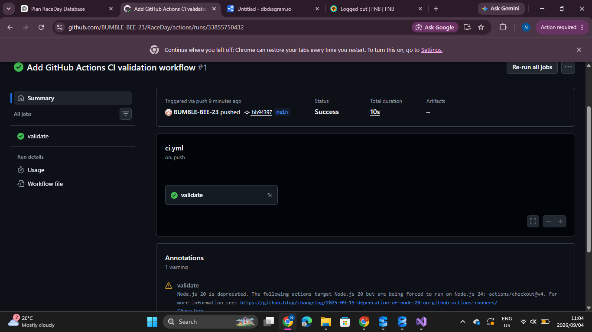

# RaceDay System

## 1. System Description

RaceDay is a race event management system designed to manage running, walking and cycling events.

The system allows organisers to create and manage race events, define categories, view participant enrolments and record race results.

Participants can register for an account, log in, view available events and categories, enrol in events and view their own race results.

The system uses ASP.NET Core Web API, C#, Entity Framework Core and Microsoft SQL Server to provide a RESTful API and relational database.

## 2. System Roles

### Organiser

The Organiser is responsible for managing race events.

An Organiser can:

- Create race events.
- View race events.
- Update and delete their own race events.
- Create event categories.
- Update and delete categories belonging to their events.
- View participants enrolled in their events.
- Record participant results.
- View results for their events.

### Participant

The Participant is responsible for entering races and viewing their own information.

A Participant can:

- Register for an account.
- Log in and log out.
- View and update their own profile.
- View available race events.
- View event categories.
- Enrol in a race event.
- Select a category when enrolling.
- View their own race results.

## 3. Database Planning and Implementation

The RaceDay system uses a relational database with the following main entities:

- Users
- Events
- Categories
- EventEnrolments
- Results

Primary keys, foreign keys, unique constraints and relationships maintain data integrity.

Entity Framework Core is used to connect the API to SQL Server. Database migrations manage the creation and updating of the database schema.

The database configuration and migration files are located in `Part2/RaceDay.API`.

The Part 1 Entity Relationship Diagram is available in `docs/RaceDay-ERD.png`, and the original SQL database script is available in `docs/RaceDay-Database.sql`.

## 4. RESTful API Endpoints

The API provides endpoints for authentication, user profiles, events, categories, enrolments and results.

| Endpoint | Method | Purpose |
|---|---|---|
| `/api/auth/register` | POST | Register a user |
| `/api/auth/login` | POST | Authenticate a user |
| `/api/auth/logout` | POST | Log out an authenticated user |
| `/api/profile/me` | GET | Retrieve the current user's profile |
| `/api/profile/me` | PUT | Update the current user's profile |
| `/api/events` | GET | List events |
| `/api/events/{id}` | GET | Retrieve an event |
| `/api/events` | POST | Create an event |
| `/api/events/{id}` | PUT | Update an event |
| `/api/events/{id}` | DELETE | Delete an event |
| `/api/events/{eventId}/categories` | GET | List event categories |
| `/api/events/{eventId}/categories` | POST | Create a category |
| `/api/categories/{id}` | PUT | Update a category |
| `/api/categories/{id}` | DELETE | Delete a category |
| `/api/enrolments` | POST | Enrol a participant |
| `/api/events/{eventId}/enrolments` | GET | List event enrolments |
| `/api/results` | POST | Record a race result |
| `/api/results/me` | GET | View the participant's results |
| `/api/events/{eventId}/results` | GET | List an event's results |

The complete Part 1 endpoint plan is available in `docs/endpoint-plan.md`.

## 5. Authentication and Role-Based Access Control

RaceDay uses cookie-based authentication and server-side session management to maintain authenticated user sessions.

Passwords are hashed before being stored in the database. The API supports the Organiser and Participant roles.

Authorisation attributes restrict protected endpoints to the appropriate role. Event ownership checks prevent organisers from modifying events and related information belonging to other organisers.

The API also validates registration roles, duplicate email addresses, category selections and enrolment requests.

## 6. SQL Server Database

Microsoft SQL Server is used as the database platform, with Entity Framework Core and the SQL Server provider handling database access.

The original Part 1 SQL script includes database creation, tables, constraints, sample data and verification queries.

The Part 2 API uses the `DefaultConnection` connection string in `Part2/RaceDay.API/appsettings.json`. The local development configuration uses SQL Server LocalDB.

To apply database migrations, run the following commands from the repository root:

```powershell
dotnet ef database update --project Part2/RaceDay.API/RaceDay.API.csproj --startup-project Part2/RaceDay.API/RaceDay.API.csproj
```

For deployment, configure the connection string for the target SQL Server environment.

## 7. API Documentation and Swagger

The RESTful API is documented using Swagger/OpenAPI.

Swagger UI allows developers to view the available endpoints, inspect request and response formats, and test API operations during development.

To run the API, execute:

```powershell
dotnet run --project Part2/RaceDay.API/RaceDay.API.csproj
```

Open the local application URL printed in the terminal and navigate to `/swagger`.

## 8. Testing

Automated tests are maintained in `Part2/RaceDay.Tests`.

The tests cover password hashing, registration, invalid roles, duplicate email addresses, login failures, event role requirements and participant enrolment validation.

To run the tests from the repository root:

```powershell
dotnet test Part2/RaceDay.Tests/RaceDay.Tests.csproj --configuration Release
```

The latest reported local test run passed **46 tests with zero failures**.

## 9. Continuous Integration and Continuous Delivery (CI/CD)

GitHub Actions is configured to validate the RaceDay repository.

The workflow is stored in `.github/workflows/ci.yml`.

The workflow checks that required Part 1 documentation exists, restores API dependencies, builds the .NET 8 API and runs the automated tests.

The workflow runs on pushes and pull requests targeting the `main` and `part2-rest-api` branches.

The latest reported local Release build and automated test run succeeded, with **46 tests passing and zero failures**. The final GitHub Actions result must be verified before submission.

### Part 1 CI/CD Screenshot



A separate screenshot of the final Part 2 GitHub Actions build should be added if required by the assessment.

## 10. Project Documentation

The repository contains the planning and implementation files for RaceDay.

Important Part 1 documents:

- `docs/RaceDay-ERD.png`
- `docs/endpoint-plan.md`
- `docs/RaceDay-Database.sql`
- `docs/CI-CD-Success.png`

Important Part 2 folders:

- `Part2/RaceDay.API` — ASP.NET Core Web API, models, controllers, database context and migrations.
- `Part2/RaceDay.Tests` — automated unit tests.
- `.github/workflows` — GitHub Actions CI/CD workflow.

## 11. Video Presentation

### Part 1 Presentation

The Part 1 presentation demonstrates the planning documents, ERD, endpoint plan, SQL Server database script and CI/CD setup.

YouTube link:

https://youtu.be/YYzX46cWQPE?si=88JKjWftkSXpd6Rv

### Part 2 Presentation

A separate Part 2 demonstration should show the running API, Swagger endpoints, authentication, role-based access, database integration and automated test results.

**Part 2 video link:** To be added after recording and uploading the demonstration.

## 12. Project Status

### Part 1 — System Planning and Database

- [x] Project folder structure created.
- [x] Entity Relationship Diagram completed.
- [x] RESTful API endpoint plan completed.
- [x] SQL Server database script completed.
- [x] SQL script tested in SQL Server Management Studio.
- [x] GitHub Actions workflow configured.
- [x] CI/CD success screenshot documented.
- [x] Part 1 presentation uploaded.

### Part 2 — RESTful API Development

- [x] ASP.NET Core Web API project created.
- [x] Entity Framework Core SQL Server integration configured.
- [x] Database migrations created and applied.
- [x] User registration and login implemented.
- [x] Password hashing implemented.
- [x] Cookie authentication and session management configured.
- [x] User profile endpoints implemented.
- [x] Event management endpoints implemented.
- [x] Category management endpoints implemented.
- [x] Participant enrolment endpoints implemented.
- [x] Race result endpoints implemented.
- [x] Role-based authorisation implemented.
- [x] Swagger/OpenAPI configured.
- [x] Automated tests implemented.
- [x] Latest reported local build and tests passed.
- [x] GitHub Actions build-and-test workflow configured.
- [ ] Final GitHub Actions result verified.
- [ ] Final Part 2 presentation uploaded.
- [ ] Final submission files reviewed.

## 13. Conclusion

RaceDay is being developed as a role-based race event management system using ASP.NET Core Web API, Entity Framework Core and SQL Server.

Part 1 established the system design, database plan and RESTful API specification. Part 2 implements the API endpoints, authentication, role-based access control, database integration, automated testing and continuous integration workflow.

The project structure supports further development of the RaceDay system in subsequent assessment stages.

